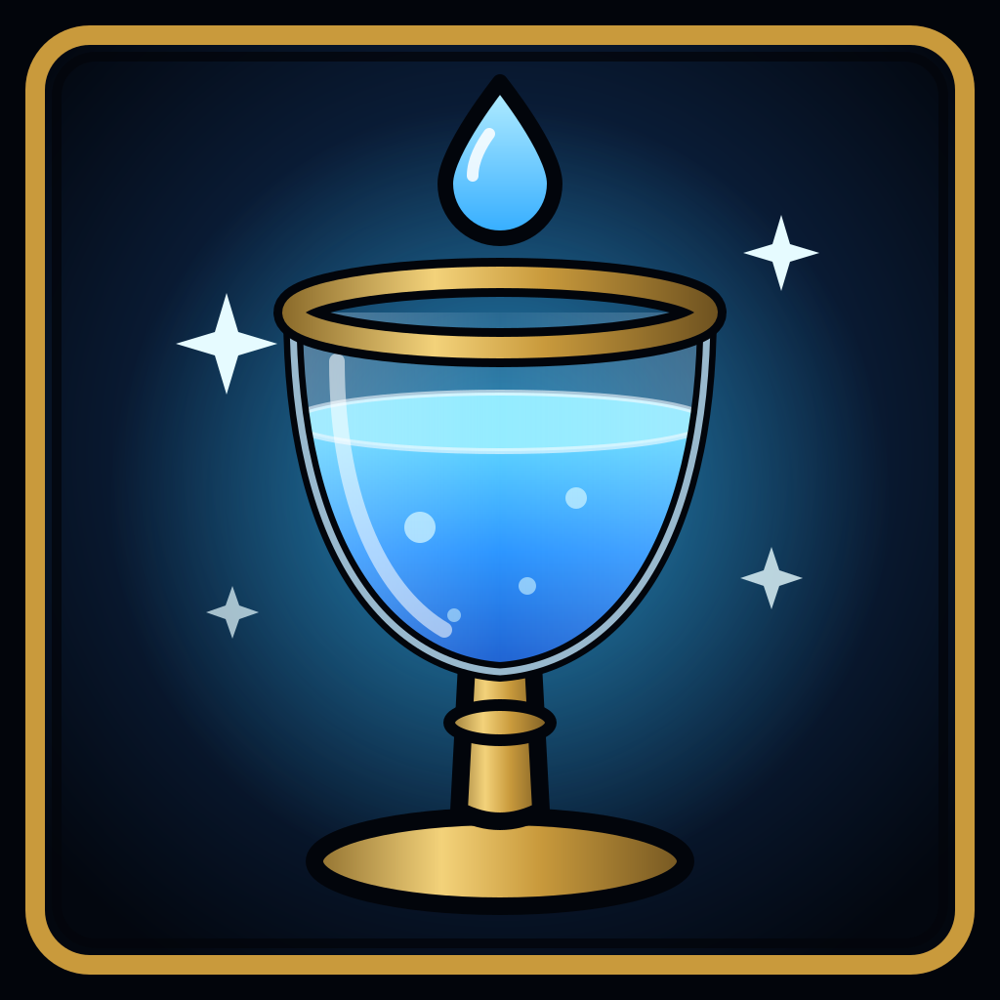
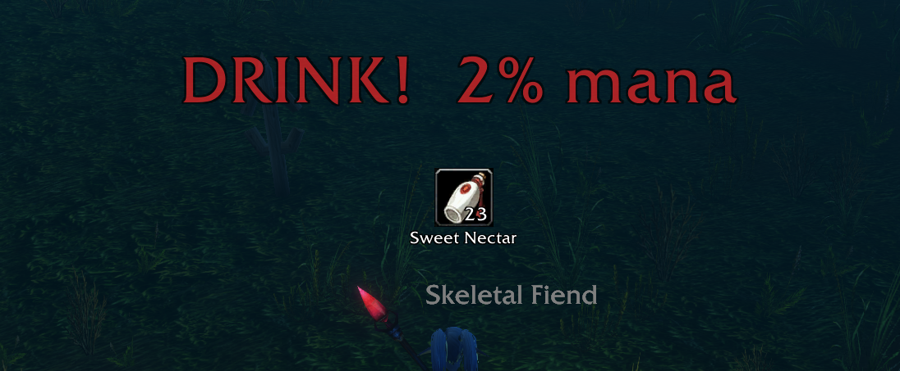
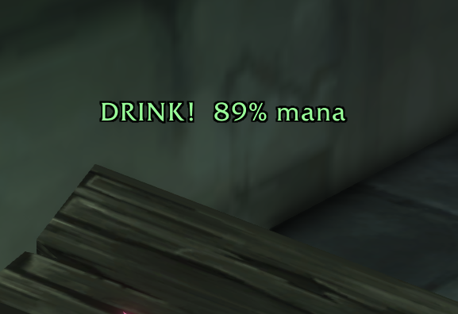

# Drink

Out of combat, out of mana, and the tank is already pulling? **Drink** tells you to drink the moment a fight ends, louder the lower your mana is, picks the right drink from your bags, and lets your group know you're sitting down. It's for anyone who uses mana: healers, tanks and damage dealers alike.

It goes by your mana, not your role or class, so there's nothing to set up per character. Characters without mana never see it.

## Features summary
### Version Support
One download for **Retail (Midnight)**, **Mists of Pandaria Classic** and **World of Warcraft: Forever**.

### Know when to drink
The moment combat ends you get an alert scaled to your mana:

| Tier | Default | Says | Looks like |
|------|---------|------|------------|
| FYI | 80%+ | Top up? | small green text, silent |
| Heads-up | 50–79% | Drink soon | yellow text, soft chime |
| Low | 20–49% | DRINK! | big orange text, ready-check sound |
| CRITICAL | under 20% | DRINK! | huge pulsing red text, raid-warning sound, red screen-edge flash |

At FYI it's just a small, silent nudge:

Each tier's wording is yours to change in the options. It skips fights shorter than 3s and stays quiet at 100% mana or when you're dead. Optionally it waits until the whole group is out of combat.

### Tell your group
- **"Drinking — 34% mana"** goes to instance, raid or party chat (picked for you) when you sit down, once per break. Never at full mana (buff food), and never again after a `/reload` mid-drink.
- **"Ready — 85% mana"** when you stand up at 80% or more, so the tank knows to go. Never while anyone is in combat.
- **"PULL - stand up!"** on your screen if the group pulls while you're still sitting.
- Optional end-of-fight mana report, `Mana: 42%`, when you finish a fight below 50%.
- Solo? Both messages print just to you instead.
- On Retail, if Blizzard's chat lockdown is on (boss fights, Mythic+), messages print locally instead of erroring.

### Which drink?
Below 80% mana after a fight, a button shows the drink that refills you with the least waste: the smallest drink in your bags that covers what you're missing. It learns how long you usually get between pulls in each zone, so a long drink you won't finish counts for less. Mage water comes first (toggle). Click it to drink, or bind a key: **Game Menu → Options → Keybindings → Drink → "Use recommended drink"**.

Each time you sit down, your chat shows how long it'll take to fill up, counting natural regen: `[Drink] Melon Juice: full in ~18s`.

### Never run dry
- **Stock check** on entering a dungeon or raid: `Drinks: 34 (~21 refills) - you're good` or `- STOCK UP`.
- **It learns your dungeons.** In a dungeon you've run before, it checks against the most a recent run there took you: `Drinks: 8 (~14 needed) - STOCK UP`.
- **Low stock mid-run:** one warning if you drop below your threshold inside.
- **Ask a mage for water:** when you're low and there's a mage in the group, an "Ask <name> for water" button appears. Nothing is sent unless you click it.

### Dungeon run tally
Inside a dungeon or raid, Drink counts the drinks you use, the time you spend drinking and the pulls that cut a drink short. Leaving prints one line:

`[Drink] Deadmines: 11 drinks, 3m 40s drinking, pulled mid-drink 2 times`

`/drink runs` lists your last 5 runs of each dungeon. Runs are saved per character and never leave your computer.

### Stays out of your way
In bear or cat form (or on Retail specs like shadow and elemental, where mana isn't what you fight with) you only hear from Drink at Low or Critical. Mages are never offered a mage-water button.

### On WoW Forever
Forever hides your exact mana from addons. Drink works around it:
- The alert still shows your real % in the right tier style, and the sound plays when the game confirms you're low.
- Your group sees "Drinking" and "Ready" without the number; your own chat still shows it.
- The drink button, stock check and run tally all work.

### Interface
Type **/drink** (or **/drinkalert**) for the options, also in the game's AddOns settings under **Drink**. Every threshold, tier, alert text, sound, flash, message and drink-buff name can be changed. Settings are shared by all your characters unless you give one its own profile.

Opening the game's **Edit Mode** unlocks the alert and the drink button so you can place them with the rest of your UI.

| Command | |
|---|---|
| `/drink` | open options |
| `/drink test fyi` / `heads` / `low` / `critical` | preview an alert tier |
| `/drink test announce` / `report` / `ready` | print a chat message to yourself (never sent) |
| `/drink test drink` | show the drink button for your current mana |
| `/drink stock` | run the stock check now |
| `/drink runs` | list your recent dungeon runs (`/drink runs clear` forgets them) |
| `/drink unlock` / `/drink lock` | move the alert and the drink button; drag the button's corner to resize it |
| `/drink debug` | log mana readability and game restrictions to chat |

Drink not recognized? Add it under **Options → Drinks → Manual drink values**.

### Bugs and ideas
[Open an issue](https://github.com/Chris221/Drink/issues) on GitHub. The source is at [github.com/Chris221/Drink](https://github.com/Chris221/Drink).

## Install
Use your addon manager, or download `Drink_vX.Y.Z.zip` from [GitHub Releases](https://github.com/Chris221/Drink/releases) and extract it into your client's `Interface\AddOns` folder (`_retail_`, `_classic_` or `_forever_`), so you end up with `Interface\AddOns\Drink\Drink.toc`.

## Changes
### Changes in 1.0.0
- First release, for WoW Forever (1.60), Mists of Pandaria Classic (5.5) and Retail/Midnight (12.x) from one folder
- Combat-end alert scaled by mana %: FYI ("Top up?", small and silent), Heads-up ("Drink soon"), Low and CRITICAL ("DRINK!"), each louder than the last, with a red screen-edge flash at Critical
- "Drinking — 34% mana" posted to instance, raid or party chat once per break; never at full mana (buff food) or after a `/reload` mid-drink
- Optional end-of-fight mana report; when solo, both messages print just to you
- "Which drink?" button after a fight: the smallest drink in your bags that refills you, learning the usual time between pulls in the zone; mage water preferred; click it or use the keybind to drink
- Stock check on entering a dungeon or raid, a mid-run "STOCK UP" warning, and an "Ask <mage> for water" button when you're low
- Dungeon run tally: drinks, drinking time and pulls that cut a drink short per run, `/drink runs` to list them, and a stock check that learns from past runs
- Drink stats line (time to full, counting regen), "Ready — 85% mana" when you stand up, and "PULL - stand up!" if the group pulls while you're sitting
- Quiet in bear and cat form (and on Retail specs that don't fight with mana) unless mana is Low or Critical; no mage-water button for mages
- Works with WoW Forever's hidden mana: the alert still shows your real %, and the game decides when you're low
- Edit Mode unlocks the alert and drink button for placing; per-character profiles; every threshold, alert text, sound and message is configurable

*Working on Drink? See [CONTRIBUTING.md](https://github.com/Chris221/Drink/blob/main/CONTRIBUTING.md).*
